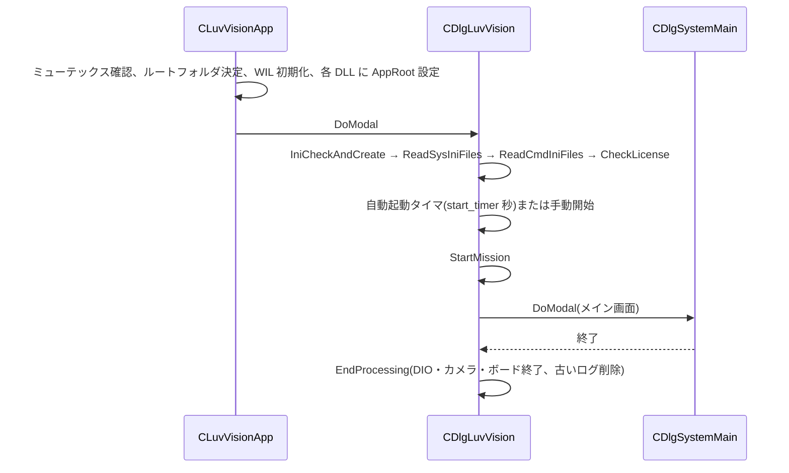
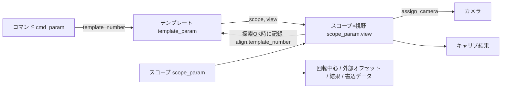
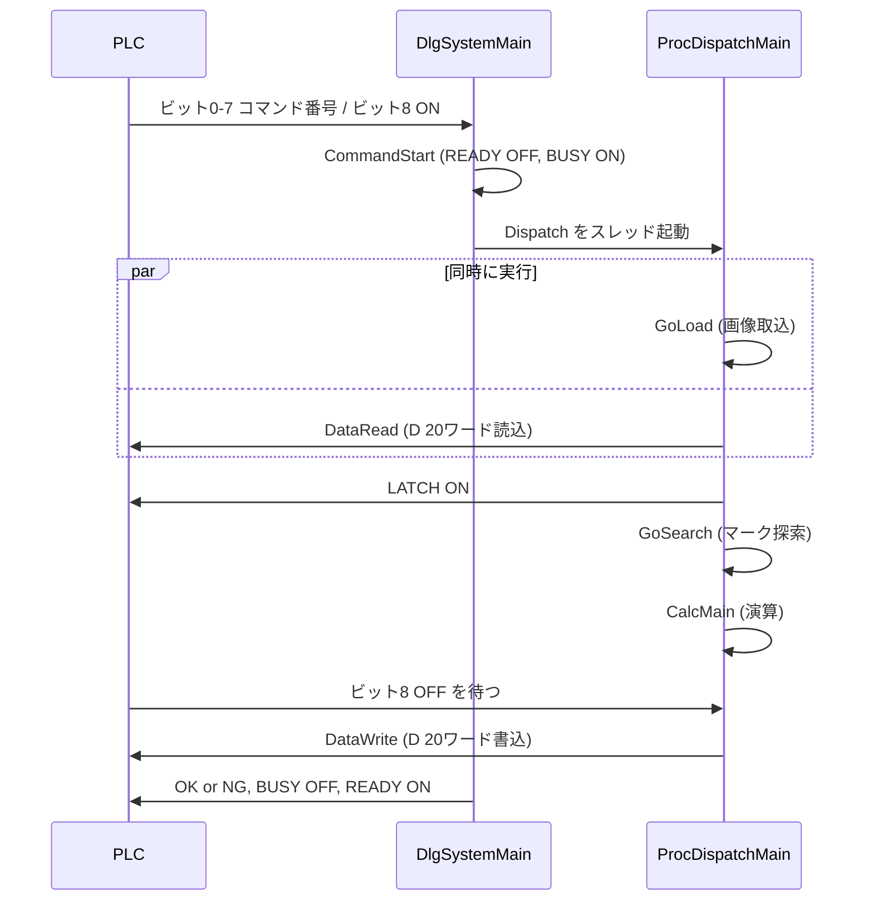

# Luv_Vision_AlignSystem 設計メモ(PC側)

- 対象バージョン:`Luv_Vision_AlignSystemVer10.21.1.3`(`Luv_Vision.h` の `SYSTEM_VERSION`)
- 記載方針:**ソースコードで確認できた事実だけ**を書く。分からないことは「不明」と書く
- 確認範囲:プロジェクト内の .cpp 194本・.h 全数。主要な処理系(Proc / Calc / 通信 / 設定保存)は中身まで確認。画面(Dlg / Tab)は役割と、本書に書いた箇所のみ確認
- 更新ルール:コードを直したら、同じコミットでこのファイルも更新する

---

## 1. システム概要

PLC からコマンドを受け取り、カメラ画像のマーク位置を **PLC の軸座標(mm)** に変換して、補正量や検査結果を PLC に返す。

- PC は軸を動かさない。何を(ステージ / カメラ / サーボ)、どの符号で動かすかは PLC 側が決める
- 計算はすべて PLC の軸座標上で行う。原点は PLC の軸の 0
- ルートフォルダ:既定は `C:\N-Vision`。起動引数 `dir=<パス>` で変更できる(`CLuvVisionApp::GetCommandParam`)
- 2重起動はミューテックス `Luv_Vision_AlignSystem` で検出し、警告を出して起動しない

---

## 2. ファイル構成と役割

| 分類 | 役割 | 主なファイル |
|---|---|---|
| 起動 | アプリ起動、初期化 | `Luv_Vision`、`DlgLuvVision` |
| メイン画面 | トリガ受付、結果表示、I/O 出力 | `DlgSystemMain` |
| コマンド処理(`Proc`) | 機能種別ごとの処理の流れ(スレッド) | `ProcDispatchMain`、`ProcGrabImage`、`ProcDataRead`、`ProcSearch`、`ProcDataWrite`、`ProcTrgFall` |
| 付帯処理(`Proc`) | 画像コピー、結果ファイル出力、ファイルアクセス | `ProcCopyImage`、`ProcOutResult`、`ProcOutResultFormula`、`ProcFileAccess`、`ProcFileOpe` |
| 計算(`Calc`) | アライメント、キャリブ、計測、バーコード、ユーティリティ | `CalcAlign`、`CalcCalib`、`CalcConv`、`CalcMark`、`CalcMes`、`CalcBcrCtrl`、`CalcFormula`、`CalcBinz`、`CalcUtil`、`CalcPLC` |
| 探索の追加機能 | エッジサーチ、2値化重心サーチ | `AddEdge`、`AddBlob` |
| PLC 通信 | MC プロトコル、ビット I/O、Ethernet トリガ | `PLCCommunication`、`MelsecTCPIP`、`DioControl`、`DioCtec1616`、`ServerTCPIP`、`EthernetTrgData`、`InterfaceRS232` |
| FTP | ファイル取得・削除 | `FtpCommunication`、`FtpMFC` |
| カメラ・ボード | 画像入力、カメラ内部パラメータ | `AvalControl`、`ImplAcapLib2`、`FastControl`、`ImplFVC08`、`UsbControl`、`ImplTeliUsb`、`ImplSentechUsb`、`RegisterControll`、`CameraRegister` |
| 設定データ | パラメータのクラス | `Commands`、`Templates`、`TempParam`、`Scopes`、`ScopeParam`、`CameraSettings`、`MesParam`、`SysOption`、`SysParamCom`、`SysParamDevice`、`CurrentStatus` ほか |
| 設定保存(`Access`) | ini ファイルの読み書き | `AccessParamSys`、`AccessParamCmd`、`AccessParamScrp`、`AccessParamTemp`、`AccessParamMes`、`AccessParamWork`、`AccessParamLyer`、`AccessParamRegi`、`AccessParamFormula` |
| 名称定義(`DefinedElement`) | コードと表示名の対応表 | `DefinedElementCmd`、`DefinedElementCam`、`DefinedElementSys`、`DefinedElementMtd`、`DefinedElementBinz` |
| DLL 連携(`ExcParam`) | 本体と各 DLL のパラメータ変換 | `ExcParamAlignBlob` ほか7本 |
| 共通 | 文字列・数値変換、ログ、エラー | `ToolTips0`、`OutputLog`、`Errors`、`Language` |
| honda 追加 | T2514 MM タイリング用の前処理 | `Cpreprocessing`(17章) |

**ビルド対象外**(`Luv_Vision.vcxproj` に含まれない):`CPointmatch.cpp`、`CalcAlign_NEW.cpp`、`SysParamFtp.cpp`

**外部 DLL**(ヘッダと .lib のみ同梱。ソースなし):`AlignBlob`、`AlignEdge`、`AlignMeas`、`AlignBarcode`、`AlignMultiSrh`、`AlignDisEdge`、`AlignDisEdgeToEdge`、`MFCControls`、`CDIO.dll`(CONTEC)。画像処理ライブラリは WIL(`FVCL`)

**文字コード**:ファイルにより Shift-JIS / UTF-16 / UTF-8(BOM付き)が混在

---

## 3. 起動と終了



**`StartMission` の順番**:`ReadScrpParam` → `ReadTempParam` → `ReadMesParam` → `ReadBcrParam` → `ReadLayerParam` → `DioInitialize` → `CamRegiUpdate` → `UsbCamInitialize(0/1)` → `GrabberInitialize(0/1)` → メイン画面。途中で失敗すると開始しない

- WIL のライセンスキーがないと、メッセージを出して開始ボタンが有効にならない
- 終了要求ビット(F ビット)の設定 `bitF_mode` が 0x02 なら、アプリ終了後に PC をシャットダウンする

---

## 4. 画面構成

```
CDlgLuvVision(起動画面)
├ システム設定 → CDlgInitialMenu(初期設定メニュー)
│   ├ PLCタイプ選択 CDlgInitialPLC
│   ├ 通信設定 CDlgInitialCom
│   ├ 画像入力設定 CDlgInitialGrab(ボード・カメラ選択、カメラ別パラメータ画面)
│   ├ カメラ座標 CDlgInitialCoordinate(coordinate_type をカメラごとに選択)
│   ├ スコープ割り当て CDlgAssignScope(スコープ×視野にカメラを割り当て)
│   ├ テンプレート割り当て CDlgAssignTemplate → CDlgTempSettingMain(スコープ・視野・機能)
│   ├ コマンド割り当て CDlgAssignCommand → CDlgCmdSettingMain
│   │     ├ CDlgCmdSettingAlign(アライメント/計測/バーコード/外部オフセット)
│   │     ├ CDlgCmdSettingCalib(キャリブ)→ CDlgCmdSettingCalCpy(コピー先)
│   │     └ CDlgCmdSettingGOTFtp(FTP)
│   ├ システムオプション CDlgSystemOption
│   └ 結果出力設定 CDlgInitOutResult
└ 開始 → CDlgSystemMain(メイン画面)
    └ ユーティリティ CDlgUtilMenu
        ├ 機種データ CDlgWorkMenu
        │   ├ テンプレート一覧 CDlgListTemplateMain → CDlgListTemplateOpe
        │   │     ├ テンプレート作成 CDlgCreateTemplate
        │   │     │     ├ マーク登録 CDlgCreatePattern / マスク CDlgModifyPattern
        │   │     │     ├ サーチ設定 CDlgCreateSearch(エッジ・2値化重心・傾き算出タブ)
        │   │     │     ├ 検査シート CDlgMesSheet / 画像合成 CDlgCreateOverlap
        │   │     │     └ 結果出力 CDlgTempOutResult
        │   │     ├ テスト実行 CDlgTrialTemplate
        │   │     └ コピー CDlgCopyTemplate
        │   └ スコープデータ一覧 CDlgListScope → 編集 CDlgEditScope
        ├ 機種切替 CDlgWorkChangeMain(コメント編集、一括コピー、個別コピー)
        ├ ツール CDlgToolMenu(描画レイヤ CDlgToolLayer、計測 CDlgToolMeas)
        └ オプション CDlgOptionMenu(システム情報、コマンド一覧、ユーザーオプション、通信テスト)
```

- デバッグモード(`sys_option.debug_mode`)はユーザーオプション画面で ON にする。保存されない(起動時は OFF)

---

## 5. データ構造

すべて固定長のグローバル配列。番号(添字)でつながっている。

| 配列 | 数 | 主な中身 | 定義 |
|---|---|---|---|
| `cmd_param[]` | 256 | 機能種別、機能コード、テンプレート番号、取込/読込/探索/演算/書込の ON/OFF、視野数、対象・目標スコープ、読込・書込タイプ、連続コマンド、実行後カメラ、キャリブのコピー先、FTP 設定、テンプレートを使わないコマンドの読込・書込データ | `Commands.h` |
| `sys_template[]` | 256 | 名称、スコープ、視野、機能(0x01 マーク探索 / 0x02 計測 / 0x03 バーコード) | `Templates.h` |
| `template_param[]` | 256 | マーク登録、探索範囲・手法・閾値、追加機能、結果出力設定、撮影画像、探索結果、PLC から読んだ値と読込タイプ | `TempParam.h` |
| `sys_scope[].view[]` | 16×4 | 割り当てカメラ(0〜7) | `Scopes.h` |
| `scope_param[].view[]` | 16×4 | キャリブ結果、座標の向き(キャリブ時に保存)、取込/読込/探索済みフラグ、最後に探索 OK だったテンプレート番号、経時変化 | `ScopeParam.h` |
| `scope_param[]` | 16 | 回転中心、外部オフセット、演算結果、PLC への書込データ | `ScopeParam.h` |
| `cam_parameter[]` | 8 | 機種コード、画像サイズ、カメラの向き(`coordinate_type`) | `CameraSettings.h` |
| `mes_param[]` | 256 | 計測シート(8枚)の設定 | `MesParam.h` |



**ポイント**
- コマンドを実行すると、そのテンプレートに画像・軸位置・探索結果が入る
- 探索 OK 時、`ProcSearch::SetScopeParam` がスコープ×視野にテンプレート番号を記録する(キャリブはポジション1/2 別に記録)
- 演算は、スコープ×視野に記録されたテンプレートから値を取り出す

---

## 6. 設定ファイル

`<ルート>` は既定 `C:\N-Vision`。機種番号は3桁(例 `001`)。

| ファイル | 中身 | 読み書き |
|---|---|---|
| `SYSTEM\Info.ini` | システム情報(現在機種など) | `AccessParamSys` |
| `SYSTEM\Com.ini` | PLC 種類、IP・ポート、D の読込・書込先頭、ASCII / バイナリ | 同上 |
| `SYSTEM\Device.ini` | ボード種類、DIO デバイス ID | 同上 |
| `SYSTEM\Scope.ini` | スコープ名、視野のカメラ割り当て | 同上 |
| `SYSTEM\Template.ini` | テンプレートのスコープ・視野・機能 | 同上 |
| `SYSTEM\Layer.ini` / `Option.ini` / `OutRslt.ini` | 描画レイヤ、システムオプション、結果出力 | 同上 |
| `SYSTEM\CMD\Command<n>.ini` | コマンド設定 | `AccessParamCmd` |
| `SYSTEM\REGI\Regist<cam>.ini` | カメラ内部パラメータ | `AccessParamRegi` |
| `SYSTEM\SPEC\ScopeCal.ini` | 画素サイズ固定(11章) | `AccessParamScrp` |
| `SYSTEM\SPEC\TemplateUniq.ini` | テンプレートの特殊設定 | `AccessParamSys` |
| `SYSTEM\SPEC\EthernetTrg.ini` | Ethernet トリガの結果表示設定 | `AccessParamCmd` |
| `WORK\<機種>\Work.ini` | 機種の登録有無、コメント、作成日時 | `AccessParamWork` |
| `WORK\<機種>\SCOPE\SParameter<n>.ini` | キャリブ結果(11章) | `AccessParamScrp` |
| `WORK\<機種>\SCOPE\SVariation<n>.ini` | 経時変化 | 同上 |
| `WORK\<機種>\T<nnn>\TParameter.ini` | テンプレート設定 | `AccessParamTemp` |
| `WORK\<機種>\T<nnn>\BaseMark.pat` | 登録マーク | `ProcSearch::LoadPattern` |
| `WORK\<機種>\T<nnn>\MES\TMeasComm.ini` / `TMeasSh<n>.ini` / `TPlcSh<n>.ini` | 計測の共通・シート・PLC 出力 | `AccessParamMes` |
| `WORK\<機種>\LAYER\WkLayer<cam>.ini` | 機種レイヤ | `AccessParamLyer` |
| `C:\N-Vision\WORK\pre_parameter.ini` | honda 追加前処理のパラメータ(固定パス) | `Cpreprocessing` |

**メモリ上だけで保存しないもの**:外部オフセット(`ext_offset_x/y/t`)、デバッグモード、マニュアルサーチ有効状態

---

## 7. コマンド1回の処理の流れ



**起動条件**:状態が `CMD_RDY` かつ READY 出力が ON のときだけ受け付ける(`RunTriggerProcess` / `RunTriggerProcessCom`)

**関数の順番**(アライメントの場合)

1. 起動:`RunTriggerProcess`(I/O ボード、`DIOM_TRIGGER`)/ `RunTriggerProcessCom`(I/O ユニットなし、または Ethernet トリガ)
2. `CommandStart` → `StartCmdLimitTimer`(10秒)→ `CDioControl::GetCommand` → `run_cmd` → `Dispatch` をスレッド起動
3. `Dispatch` → 機能種別で分岐(9章)。終了後、0x17 以外ならマニュアルサーチ有効を解除
4. `ProcInit`:コマンドの ON/OFF を `thread_rq` に展開(テンプレートを使わないコマンドは固定。9章)
5. `RunThreadGrab`(`GoLoad`)と `RunThreadRead`(`DataRead`)を同時に開始
6. `WaitThreadGrab` → LATCH ON → `CheckGrabError`
7. 画像合成の設定があれば `ProcCopyImage::CopyToGrab`(12章)
8. `RunThreadSrch`(`GoSearch`)→ `WaitThreadRead` → `RunThreadWriteLatch` → `WaitThreadSrch` → `CheckSrchError` → `CheckReadError`
9. 探索 NG かつマニュアルサーチ有効なら `GoManual`(マニュアルサーチ中ビット ON/OFF)
10. キャリブ基準位置の使用が ON なら読込タイプを 0xFF に上書き。読込タイプ 0x03 なら外部オフセットを保存(12章)
11. スコープ×視野に取込/読込/探索済みフラグ。画像保存・結果ファイル出力
12. 演算 ON なら `CheckCalcRunAlign` → `CalcMain`
13. `RunThreadChkTrg`(`CheckTrgFall`:ビット8 の OFF を 10ms 周期で監視)→ `WaitThreadChkTrg`
14. `SetOutData` → `RunThreadWrite`(`DataWrite`)
15. `JudgeOKNG` → `CheckChain` → `ChangeCamera` → `DeleteThread`
16. `OnCommandSuccess` → `OutBitSuccess`(連続コマンドなら `OnCommandChain`)/ 失敗時 `OnCommandFail` → `OutBitFail`

**待ち時間(`WaitForSingleObject`)**

| 待つ処理 | 上限 | 超過時のエラー |
|---|---|---|
| 画像取込 | 1000ms | 0x910F |
| データ読込 | 1000ms | 0x920F |
| マーク探索 | 3000ms | 0x930F |
| データ書込 | 3000ms | 0x921F |
| ビット8 の OFF | 1000ms | 0x950F |
| LATCH 書込(I/O ユニットなし) | 1000ms | — |

- コマンド実行時間タイマ(10秒)は、連続コマンドを続けるかの判定にだけ使う。超えていたら連続コマンドを止め、0x9601 を書き込む

**OK / NG の判定(`JudgeOKNG`)**:探索 NG、演算未実施、演算エラーコードあり、計測の総合 NG、バーコード NG のどれかがあれば NG

**連続コマンド(`CheckChain`)**:OK 時 / NG 時に実行するコマンド番号(0〜255)を設定できる。PLC のトリガなしで次を実行する

---

## 8. PLC とのインターフェース

### 通信

- 三菱 MC プロトコル(3E フレーム)、TCP/IP。ASCII / バイナリは `com_parameter.com.type`
- IP・ポート:`com_parameter.tcp`
- キーエンス KV:未対応(常に失敗を返す)
- すべての通信は `comm_mutex` で排他

### ビット(PLC → PC)

| ビット | 定数 | 中身 |
|---|---|---|
| 0〜7 | — | コマンド番号(0〜255) |
| 8 | `IN_STO` | 起動トリガ(立ち上がりで起動、立ち下がりを待つ) |
| 9〜14 | `IN_DT1`〜`IN_DT6` | 「ダイレクト制御トリガ」と定義。立ち上がりを監視しているが、処理はない |
| 15 | `IN_FBT` | F ビット(立ち下がりで `bitF_mode` に従い終了 / シャットダウン) |

### ビット(PC → PLC)

| ビット | 定数 | 中身 |
|---|---|---|
| 0 | `OUT_RDY` | READY |
| 1 | `OUT_BSY` | BUSY |
| 2 | `OUT_LAT` | LATCH(画像取込完了) |
| 3 | `OUT_OK` | OK |
| 4 | `OUT_NG` | NG |
| 5 | `OUT_OV` | OVER(OFF にする処理だけあり、ON にする処理はない) |
| 13 | `OUT_ERR` | システム異常 |
| 14 | `OUT_MAN` | マニュアルサーチ中 |

- I/O ボードあり:CONTEC DIO-1616(ポート0 でコマンド番号を読む)
- I/O ユニットなし(`sys_option.io_unit_less`):Y デバイス(PLC → PC)と X デバイス(PC → PLC)を1ワードずつ、100ms 周期で読み書き(`TrRWBit`)。約10秒ごとに接続を閉じ直す

### Ethernet トリガ(I/O ユニットなしのときだけ起動)

- `ServerTCPIP`:TCP ポート 0x4000(16384)で待ち受け
- 受信:1語目がコマンド番号、続く最大3語がデータ(結果表示の切替用 `eTrgData`)
- 応答:ASCII なら `"E000"`、バイナリなら `0xE0 0x00` を**状態に関係なく**返す
- コマンド番号が 0〜255 なら `WM_APP_COMMAND_TRG_PROCESS` を送り、`RunTriggerProcessCom` で起動。READY でないときは何もしない

### ワード(D デバイス、20ワード)

**PLC → PC**(先頭:`com_parameter.device.read_number`)

| ワード | 中身 | 単位 |
|---|---|---|
| w[0..1] | 軸位置 X / 外部オフセット X | 1mm = 10000 |
| w[2..3] | 軸位置 Y / 外部オフセット Y | 1mm = 10000 |
| w[4..5] | 軸位置 T(キャリブ時のみ読む)/ 外部オフセット T | 1deg = 10000 |
| w[10] | `0x4449`("ID")なら、w[11..19] を ID 文字列(18文字)として結果ファイル名に使う | — |

テンプレートを使わないコマンドは、コマンドごとに別の意味で使う(9章)。

**PC → PLC**(先頭:`com_parameter.device.write_number`)

| ワード | アライメント | 計測 | キャリブ | バーコード |
|---|---|---|---|---|
| w[0..1] | θX または ΔX(0.1µm) | w[0]:シート0〜7 の OK ビット | 画素サイズ(0.1nm)/ 回転中心X(0.1µm)/ ずれX(0.1mpix) | 読取文字 w[0..14] |
| w[2..3] | θY または ΔY(0.1µm) | w[2..16]:シートごとに設定 | 傾き(0.1mdeg)/ 回転中心Y / ずれY | 同上 |
| w[4..5] | Δθ(0.1mdeg) | 同上 | — | 同上 |
| w[6..13] | マーク間距離(0.1µm) | 同上 | — | 同上 |
| w[17] | 実行コマンド番号 | ← | ← | ← |
| w[18] | 0x1000 × カメラ番号 + 機種番号 | ← | ← | 機種番号のみ |
| w[19] | エラーコード(正常時 0) | ← | ← | ← |

- 32bit 整数を2ワードに分けて格納
- テンプレートを使うコマンドの書込データは、テンプレートの**スコープ単位**(`scope_param[].plc.write_data`)。同じスコープを使う別のコマンドで上書きされる
- エラー時(`DataWriteErr`)は全部 0 に w[17]・w[19] だけ

---

## 9. 機能種別ごとの処理

| 機能種別 | 名称 | 処理関数 | 計算 | テンプレート |
|---|---|---|---|---|
| 0x01 | アライメント | `DispatchAlign` | `CCalcAlign` | 使う |
| 0x02 | 計測モード | `DispatchMes` | `CCalcMes` | 使う |
| 0x03 | キャリブレーション | `DispatchCalib` | `CCalcCalib` | 使う |
| 0x04 | バーコードリーダー | `DispatchBarcode` | `CCalcBcrCtrl` | 使う |
| 0x12 | 機種切替 | `DispatchWorkChange` | `CalcExec_12` | — |
| 0x13 | カメラ切替 | `DispatchCamChange` | `CalcExec_13` | — |
| 0x16 | ファイルアクセス | `DispatchFileAccess` | `CalcExec_16` | — |
| 0x17 | マニュアルサーチ有効 | `DispatchManualAlign` | `CalcExec_17` | — |
| 0x41 | 外部オフセット設定 | `DispatchExtOffset` | `CalcExec_41` | 使う(スコープ決定のみ) |
| 0x51 | オリジナル記号文字列 | `DispatchFormatSet` | `CalcExec_51` | — |
| 0x52 | FTP ダウンロード | `DispatchFTPDownload` | `CalcExec_52` | — |
| 0x53 | FTP 削除 | `DispatchFTPRemove` | `CalcExec_53` | — |
| その他 | 未定義 | `DispatchNotCmd` | — | エラー 0x5001 |

**機能コード(`search.method`)**:0x0101 中点一致 / 0x0102〜0x0105 端点一致 視野1〜4 / 0x0201 計測 / 0x0306〜0x0309 画素・回転中心キャリブ ポジション1・2 / 0x0310〜0x0312 経時変化 / 0x0401 バーコード(`DefinedElementCmd`)

**テンプレートを使わないコマンド**(`ProcInit` で読込・演算・書込が固定で ON。0x17 は読込なし)

| 機能種別 | PLC から読む内容 | 処理 |
|---|---|---|
| 0x12 | w[0]:機種番号(1〜999) | 未作成なら 0x4122。スコープ・テンプレート・計測・バーコードの ini を読み直し、`current.work_number` を更新 |
| 0x13 | w[0]:表示カメラ番号 | メイン画面の表示カメラを変える(範囲チェックなし) |
| 0x16 | w[0..1]:"CD" / "RS" / "LOAD" / "SAVE"、w[2]:デバイス文字、w[4]:先頭、w[5]:点数、w[6..]:ファイル名 | `<ルート>\PLCDATA\` 以下とデバイスの間でデータを読み書き |
| 0x17 | — | 次のコマンド1回だけマニュアルサーチを有効にする |
| 0x41 | w[0..5]:オフセット X,Y,T | テンプレートのスコープの `ext_offset_*` に保存 |
| 0x51 | w[0]:識別文字2文字、続けて文字列 | 結果ファイル名のオリジナル記号に値を入れる |
| 0x52 / 0x53 | — | コマンドに設定した FTP サーバー・パスでダウンロード / 削除 |

---

## 10. 座標系と変換(`CalcConv`)

1. `ConvDirection`:`(マーク位置 − Cal基準)` を `coordinate_type`(0〜7)で X,Y 入替・符号反転
2. `ConvMechCoord`:θ = `crdnt_radian`、s = `pixel_size` として
   - メカX = 軸X + ( dx·cosθ + dy·sinθ) × s
   - メカY = 軸Y + (−dx·sinθ + dy·cosθ) × s

| 読込タイプ(テンプレート) | 軸位置に使う値 |
|---|---|
| 0x01 視野位置 | 撮影時に PLC から読んだ値(`GetAxisPosXY`) |
| 0x03 外部オフセット | 軸基準 |
| 0xFF キャリブ基準位置を使用 | 軸基準 |

- マークが Cal基準に写れば、メカ座標 = 軸位置
- 読込タイプはコマンドの設定を `DataRead` がテンプレートにコピー。キャリブ基準位置の使用が ON なら `DispatchAlign` が 0xFF に上書き
- **カメラの向きの参照元が処理で違う**
  - アライメント・回転中心キャリブ:画素キャリブ時にスコープ×視野へコピーした値(`scope_param[].view[].coordinate_type`)
  - 計測(基準-エッジ距離、エッジ-エッジ距離):カメラ設定の現在値(`cam_parameter[].coordinate_type`)

---

## 11. キャリブレーション(`CalcCalib`)

| 機能コード | 中身 | 演算 |
|---|---|---|
| 0x0306 | 画素キャリブ ポジション1 | なし(ON にすると想定外エラー) |
| 0x0307 | 画素キャリブ ポジション2 | あり |
| 0x0308 | 回転中心キャリブ ポジション1 | なし(ON にすると想定外エラー) |
| 0x0309 | 回転中心キャリブ ポジション2 | あり |
| 0x0310 | 経時変化 基準指定 | あり |
| 0x0311 | 経時変化 補正算出 | あり |
| 0x0312 | 経時変化 補正リセット | あり |

**コマンド設定画面(`CDlgCmdSettingCalib`)**
- テンプレートは機能が「マーク探索」(0x01)のものだけ選べる。読込タイプは「視野位置(X,Y,θ)」のみ
- 機能を選ぶと、演算・書込タイプ・コピー先の有効/無効が自動で切り替わる

| 機能 | 演算 | 書込タイプ | コピー先 |
|---|---|---|---|
| 0x0306 / 0x0308 | OFF | データ無し | 選べない |
| 0x0307 | ON | 0x30 画素/傾き | 選べる |
| 0x0309 | ON | 0x31 回転中心 | 選べる |
| 0x0310 / 0x0312 | ON | データ無し | 選べる(0x0312 は取込・探索も OFF) |
| 0x0311 | ON | 0x50 経時変化 | 選べる |

- コピー先:なし / スコープ1〜16(視野も選ぶ)/ カスタム(複数のスコープ×視野)

### 画素キャリブ(0x0307 の演算)

1. `CheckCalcRunCalib`:`calib.pixel.enable[0]`・`[1]` が ON
2. `PixelCalcDataSet`:`calib.pixel.template_number[0/1]` のテンプレートから、マーク位置と軸位置(`GetAxisPosXY`)を配列へ。カメラの向き設定をコピー
3. `PixelCalcExec`:Cal基準 = マーク位置の中点、軸基準 = 軸位置の中点 → `ConvDirection` → `GetPixelSize`
4. `GetPixelSize`:X だけ or Y だけ動かした2点から、画素サイズ = 軸移動量 ÷ 画像移動量、傾き = atan
5. `CopyOne` / `CopyCustom`(コピー設定時)
6. `DispatchCalib`:`pixel_complete` ON → `CopyCalibOne` / `CopyCalibCustom` → `WriteResultCalib`(ini 保存)
7. `PixelCalcDataOut`(書込タイプ 0x30)

### 回転中心キャリブ(0x0309 の演算)

1. `CheckCalcRunCalib`:同じ視野の `pixel_complete`、`calib.theta.enable[0]`・`[1]`
2. `ThetaCalcDataSet`:マーク位置、`GetAxisPosXY`、`GetAxisPosT`
3. `ThetaCalcExec`:`ConvDirection`(画素キャリブの Cal基準)→ `ConvMechCoord` → 角度差 \|T2 − T1\| → `GetRotCenter` → `scope_param[].conf_rotcent_x/y`
4. コピー → `theta_complete` / `calib_theta_complete` ON → `WriteResultCalib`
5. `ThetaCalcDataOut`(書込タイプ 0x31)

### 経時変化

- `VariationDataSetBase` / `VariationDataSetMove` → `VariationCalcExec` / `VariationCalcReset`
- ずれ(pix)は `CalcDataConv` でマーク位置から差し引かれる
- `WriteResultVaria`(`SVariation<n>.ini`)、`VariationDataOut`(書込タイプ 0x50)

### 保存される値(`SParameter<n>.ini`)

- 視野ごと:`pixel_size`、`crdnt_radian`、`coordinate_type`、`pixel_complete`、`theta_complete`、画素キャリブ・回転中心キャリブの詳細(各2点の軸位置・マーク位置・変換値、Cal基準、軸基準)
- スコープごと:`conf_rotcent_x/y`、`conf_rotcent_view`、`calib_theta_complete`

### 画素サイズの固定(`SYSTEM\SPEC\ScopeCal.ini`)

- `[Scope<n>View<m>]` に `pixel_size=` があると、機種読込時にその値を画素サイズにし、`pixel_complete` を TRUE にする(`ReadIniFilePixel`)
- 設定するのは画素サイズと完了フラグだけ。傾き・Cal基準・軸基準は変えない
- スコープデータ編集画面では、その視野の画素サイズ欄が編集不可になる

### スコープデータ編集(`CDlgEditScope`)

- 行を選んで、4視野分の値を手で書き換えて ini に保存する
- 編集できる行:画素サイズ(µm 表示)、傾き(deg)、Cal基準 X/Y、軸基準 X/Y、回転中心 X/Y
- 画素キャリブ未完了の視野、回転中心キャリブ未完了のスコープは書き換えない

---

## 12. アライメント(`CalcAlign`)

| 機能コード | 機能 | 視野数 |
|---|---|---|
| 0x0101 | 中点一致 | 2 / 4 |
| 0x0102 / 0x0103 | 端点一致 視野1 / 2 | 1 / 2 |
| 0x0104 / 0x0105 | 端点一致 視野3 / 4 | 1 |

- 使う視野:視野数 n なら視野1〜n。視野数1は機能で決まる視野
- 3視野は未対応

| 目標スコープ | 目標座標 |
|---|---|
| 0〜15 | 相手スコープのマークのメカ座標 |
| 16 基準(移動) | 対象を撮影したときの軸位置(`align.axis_x/y`) |
| 17 基準(固定) | 軸基準(`calib.pixel.axis_base_x/y`) |

**関数の順番**

1. `CheckCalcRunAlign`:使う視野すべてで画素キャリブ完了、取込・読込・探索済み(回転中心キャリブはチェックしない)
2. `CalcMain` → `CalcDataSet`(対象)、`CalcDataSet`(目標。16/17 は省略)
3. `CalcDataConv`:マーク位置 → 経時変化を差引 → `ConvDirection` → 軸位置 → `ConvMechCoord`
4. `MidPointCalcExec` / `EndPointCalcExec`:目標・対象の座標、対象スコープの回転中心、外部オフセットを用意
5. 補正演算
   - `TwoPartsAlignment`:Δθ = 目標の2点の角度 − 対象の2点の角度、ΔX,ΔY = 中心の差、θX,θY = Δθ 回転後の差
   - `OnePartsAlignment`:ΔX,ΔY のみ(Δθ、θX,θY は 0)
   - `FourPartsAlignmentRev2`(新):Δθ は視野1,2、X,Y は4点の中心。`FourPartsAlignment`(旧)は `sys_option.fourparts_align == 1` のとき
6. `CalcMarkWidth` → `SetStatistics`(直近100件)→ `SetResult` → `CmdLogOut` / `DebugLogOut`
7. `SetOutData` → `AlignCalcDataOut`

- 回転中心キャリブ未完了なら θX,θY = 0
- 形状サーチで検出したマークの角度・スケールは使っていない(`GetMarkFPM2`)

**外部オフセット**

- 書き込む経路は2つ
  - 外部オフセット設定コマンド(0x41):テンプレートのスコープに保存
  - アライメントで読込タイプ 0x03:目標スコープが 0〜15 ならそのスコープ、16/17 なら対象スコープに保存。それ以外は処理を中断(ISSUE-15)
- 演算での参照:目標スコープが 0〜15 ならそのスコープ、16/17 なら対象スコープの値
- ini に保存しない。機種切替(`InitParams`)と再起動で 0 に戻る

**画像合成**

- テンプレートの `make_image[0].make_type` が 0x01 なら、取込直後に `CopyToGrab` で、指定テンプレートの計測シート(機能 0x11 画像コピー)で切り出した画像を撮影画像に貼り付けてから探索する(アライメント・計測)

---

## 13. 計測・バーコード・結果出力

### 計測モード(`CCalcMes`)

- 視野数は1固定(`CalcDataSet` は 1 以外でエラー)
- 基準点探索が有効なら、マーク位置を `scope_param[scope].view[0].align.mark_x/y` に入れ、全シートの基準にする(テンプレートの視野に関係なく view[0])
- 8シートを順に実行

| シート機能 | 中身 | 実装 |
|---|---|---|
| 0x00 | なし(OK 扱い) | — |
| 0x01 | ブロブ | `AlignBlob` DLL |
| 0x02 | エッジ | `AlignEdge` DLL |
| 0x03 | 濃度 | `AlignMeas` DLL |
| 0x04 | マルチ探索 | `AlignMultiSrh` DLL |
| 0x05 | 基準-エッジ距離 | `AlignDisEdge` DLL |
| 0x06 | エッジ-エッジ距離 | `AlignDisEdgeToEdge` DLL |
| 0x11 | 画像コピー | `ProcCopyImage::CopyToMem` |
| 0x21 | 計算(他シートの結果を使う) | `CCalcFormula` |

- 画素キャリブ未完了なら、画素サイズ・傾きを 0 として DLL に渡す
- 総合判定:全シート OK で OK
- PLC 出力:w[0] にシートごとの OK ビット、w[2..16] は機能ごとの出力設定(`MesCalcDataOut`)

### バーコード(`CCalcBcrCtrl`)

- `AlignBarcode` DLL で読み取り、文字を w[0..14] に出力(書込タイプ 0x40)
- 演算前チェック `CheckCalcRunBcr`:取込・探索済み(エラー 0x60xx)

### 結果ファイル出力(`ProcOutResult`)

- テンプレートごとに有効化。出力先は `sys_option.template_result_dir`
- 探索結果・アライメント結果・計測結果を CSV、画像を BMP / JPEG で保存(画像は NG 時 / OK 時 / 常に)
- ファイル名の書式記号:`"固定文字"`、`<ID>` `<TN>`(テンプレート番号)`<JD>`(OK/NG)`<WN>`(機種)`<YYYY>` `<MM>` `<DD>` `<hh>` `<mm>` `<ss>` `<ms>`、`(記号)`(オリジナル記号。0x51 コマンドで値を入れる)

### コマンド画像保存(`ProcSearch::SaveImage`)

- `sys_option.image_save_mode`(なし / NG のみ / OK のみ / 全て)に従い、`image_save_dir\<年月日>\<年月日>_<時分秒>_T<nnn>_<OK/NG>.bmp(.jpg)` に保存

---

## 14. エラーコード

**PLC の w[19] に書くコード**

| コード | 内容 | 出す場所 |
|---|---|---|
| 0x9101 + 0x0010×(カメラ+1) | 画像取込失敗 | `CheckGrabError` |
| 0x910F | 画像取込スレッド異常・タイムアウト | `WaitThreadGrab` |
| 0x9201 | データ読込失敗 | `CheckReadError` |
| 0x920F / 0x921F | 読込 / 書込スレッド異常・タイムアウト | `WaitThreadRead` / `WaitThreadWrite` |
| 0x9301 / 0x9302 / 0x9303 | 基準点 / エッジ / 2値化重心 探索の処理失敗 | `GoSearch` |
| 0x9309 | 探索失敗(詳細コードなし) | `CheckSrchError` |
| 0x930F | 探索スレッド異常・タイムアウト | `WaitThreadSrch` |
| 0x0100×スコープ + 0x0010×(視野+1) + 1/2/3 | 基準点 / エッジ / 2値化重心 探索 NG | `GoSearch` |
| 0x9411 / 0x9412 / 0x9413 | アライメント データセット / 中点一致 / 端点一致 失敗 | `CCalcAlign::CalcMain` |
| 0x9419 | アライメント演算失敗(詳細なし) | `CheckCalcError` |
| 0x9421〜0x9427 | 計測 データセット / ブロブ / エッジ / 濃度 / マルチ探索 / 基準-エッジ / エッジ-エッジ 失敗 | `CCalcMes` |
| 0x9429 | 計測演算失敗(その他) | `CCalcMes` / `CheckCalcError` |
| 0x9431 / 0x9432 / 0x9433 / 0x9439 | キャリブ データセット / 画素 / 回転中心 失敗 / 想定外 | `CCalcCalib::CalcMain` |
| 0x9442 / 0x9449 | バーコード演算失敗 / 想定外 | `CCalcBcrCtrl` |
| 0x9451 / 0x9452 / 0x9453 | 経時変化 データセット / 算出 / リセット 失敗 | `CCalcCalib::CalcMain` |
| 0x950F | ビット8 OFF 待ちのタイムアウト | `WaitThreadChkTrg` |
| 0x9601 | 連続コマンド実行時間(10秒)超過 | 各 Dispatch |
| 0x4121 / 0x4122 | 機種切替 番号範囲外 / 未作成機種 | `CalcExec_12` |
| 0x4161 / 0x4162 / 0x4163 / 0x4169 | ファイルアクセス CD / LOAD / SAVE 失敗 / 未定義コマンド | `CalcExec_16` |
| 0x4411 | 外部オフセット設定 データ取得失敗 | `CalcExec_41` |
| 0x4511 / 0x4512 | 文字列設定 文字列異常 / 識別文字異常 | `CalcExec_51` |
| 0x4611 / 0x4612 / 0x4613 | FTP ログイン / ディレクトリ移動 / ダウンロード・削除 失敗 | `CalcExec_52/53` |
| 0x5001 | コマンド未設定 | `DispatchNotCmd` |

**演算前チェック(`CheckCalcRun*`)のコード**

| コード | 内容 |
|---|---|
| 0x10vX(v = 対象視野+1) | アライメント 対象側:X = 1 取込未完了 / 2 読込未完了 / 3 探索未完了 / 8 画素キャリブ未完了 |
| 0x1v0X(v = 目標視野+1) | アライメント 目標側:同上 |
| 0x101C / 0x110C | 視野数1で機能から視野を決められない(対象 / 目標) |
| 0x20vX | 計測:1 取込未完了 / 3 探索未完了 |
| 0x3svX(s = スコープ) | キャリブ:1/2 画素 ポジション1/2 未完了、3 画素想定外、4 画素キャリブ未完了、5/6 回転中心 ポジション1/2 未完了、7 回転中心想定外 |
| 0x60vX | バーコード:1 取込未完了 / 3 探索未完了 |

---

## 15. 設定値の一覧

**機能種別(`base_method`)**:9章

**読込タイプ(コマンド `read.type`)**:0x01 視野位置 / 0x03 外部オフセット(0x02 / 0x04 / 0x06 は定義のみで未使用)

**書込タイプ(`write.type`)**:0x00 データ無し(全部 0)/ 0x01 θX,θY,Δθ,W / 0x02 ΔX,ΔY,Δθ,W / 0x20 計測結果 / 0x30 画素キャリブ / 0x31 回転中心 / 0x40 バーコード / 0x50 経時変化

**システムオプション(`SysOption.h`)**

| 項目 | 中身 |
|---|---|
| `bitF_mode` | F ビット:なし / アプリ終了 / PC シャットダウン |
| `start_timer` | 自動開始までの秒数(0 で手動) |
| `fourparts_align` | 4視野演算 0:新 / 1:旧 |
| `io_unit_less` | TRUE:I/O ボードなし(Ethernet でビット通信) |
| `x_device_start_number` / `y_device_start_number` | ビット通信の X / Y デバイス先頭 |
| `image_save_mode` / `file_type` / `image_save_dir` | コマンド画像保存 |
| `template_result_dir` | 結果ファイル出力先 |
| `cmd_view_time` | コマンド後の結果表示時間(秒) |
| `debug_mode` | デバッグログ。保存しない |

**アライメントのコマンド設定画面(`CDlgCmdSettingAlign`)**
- `OnInitDialog` → `ControlInitialization` → `EnableControl` → `LoadParameter`
- OK → `CheckParameter` → `ChangeParameter`
- 対象と目標に同じスコープを選ぶと、保存時に目標が 16(基準・移動)に変わる
- 演算 OFF で保存すると、機能・視野数・対象・目標スコープは未定義(-1 など)に戻る

---

## 16. 前提条件(PC 側でチェックしていない)

| 前提 | 守らないと |
|---|---|
| 各テンプレートの軸の値が、同じメカ原点・同じ向き・同じ単位 | 別カメラ同士の差が意味を持たない |
| `coordinate_type` が正しい(軸 + で変換後の値が −) | 軸位置によってメカ座標が変わる |
| カメラの向き設定を変えたら画素キャリブをやり直す | アライメントはキャリブ時の向きのまま計算する(10章) |
| 画素キャリブは X か Y の片方だけ動かし、T は回さない | 画素サイズ・傾きがずれる |
| コマンド実行中は軸を止める(取込と読込が同時に動くため) | 画像と軸位置がずれる |
| PLC はビット8 を、LATCH 後に速やかに OFF にする | 1秒を超えると 0x950F |
| 回転軸は対象側に1つ、回転中心は動かない、θ を回しても X,Y の向きは変わらない | θX,θY が合わない |
| 画素は縦横同じ大きさ、X 軸と Y 軸は直角 | 測っていない方向に誤差 |
| ポジション1(0x0306 / 0x0308)のコマンドは演算 OFF | 想定外エラー |
| 視野数2 では視野3,4 は使われない | 設定しても無視される(警告なし) |
| 外部オフセットは機種切替・再起動のたびに PLC から送り直す | 0 に戻っている |
| ScopeCal.ini で画素サイズを固定する視野も、傾き・Cal基準は別途設定する | 傾き・Cal基準は ini の値のまま |

---

## 17. honda 追加分(T2514 MM タイリング)

| 場所 | 内容 |
|---|---|
| `Cpreprocessing.cpp/.h`(新規) | 前処理 `Improve5`:輝度調整 → 平均化 → 加算 → 差分 → Pタイル2値化 → 幅調整 → ノイズ除去 → 濃度補正 → くり抜き → 合成 |
| `ProcGrabImage::GoLoad` | 画像取込の最後で **毎回** `pre.Improve5()` を呼ぶ |
| `AvalControl::GetLastImage` | コマンド取込のたびに `C:\E35088\B\Live画像.bmp` を保存 |
| `DlgCreatePattern::OnBnClickedButton12` | マーク登録画面に前処理ボタンを追加。BMP を選び、`Improve5` 実行後 `I5_4_PTile.bmp` を表示 |
| `DlgSystemMain::OnBnClickedButton12` → `Improve5` ほか | メイン画面にも同様の処理(`Improve1`〜`Improve5`)。`C:\E35088\` の固定ファイルを読み書き |
| `DlgCreateSearch::TrialEdgeGo` | ビルドエラーのため `TrialEdge` の呼び出しをコメントアウト |
| `ProcDispatchMain.h` | `RunThreadGrab` を public static に移動 |

**`Improve5` の動き(コードで確認できたこと)**
- 入力は撮影画像ではなく、ファイル `C:\E35088\B\Live画像.bmp`(`LoadImageFile` の戻り値は確認していない)
- パラメータは `C:\N-Vision\WORK\pre_parameter.ini` から `GetPrivateProfileIntA` で読む(整数のみ)
- 途中結果を `C:\E35088\B\I5_*.bmp` などに保存する
- 結果はファイルに保存するだけで、`template_param[].m_Image`(探索に使う画像)は変更しない
- 失敗時は `MessageBoxA` を出して戻る

---

## 18. 既知の問題

### 重要度の基準

重要度はコードから読める「発生条件」と「影響」で判断した。

| 重要度 | 基準 | 対応 |
|---|---|---|
| 高 | 通常の画面設定で起こり、PLC に誤った補正量を出す、または本番のコマンドを止める | 要対応 |
| 中 | 条件付きで誤った値やコマンド失敗になる。または意図が不明で、仕様を確認しないと直し方が決まらない | 仕様確認のうえ対応を判断 |
| 低 | 設定画面・ログ・保守性だけの問題、または通常の設定では起こらない | 任意(ついでに直す) |

### 一覧

| ID | 重要度 | 対応 | ファイル | 内容 | 発生条件と影響 |
|---|---|---|---|---|---|
| ISSUE-01 | 高 | 要対応 | `CalcAlign` | 端点一致・1視野・基準(固定)は読込タイプ 0x02 のときしか目標をセットしない | 0x02 は画面で選べないので、この組み合わせを選ぶと常に目標 (0,0) で計算される。補正量 = −(対象のメカ座標) が PLC に出る |
| ISSUE-02 | 高 | 要対応 | `CalcAlign` | 4視野・基準(固定)で、4視野の軸基準がすべて同じとき、目標を「撮影時の軸位置 ±0.1mm」にしている(コメント「とりあえず0.1mmを入れる」) | キャリブ結果を1視野から4視野へコピーすると軸基準は同じになる。その場合、固定ではなく移動に近い目標で補正量が出る |
| ISSUE-05 | 高 | 要検証 | `CalcCalib` | 回転角を `fabs` で絶対値にしており、`GetRotCenter` は中心を弦のどちら側に置くかを回転方向ではなく2点の位置関係だけで決めている | キャリブで回す向きによっては、回転中心が正しい位置の反対側に出る可能性がある。その回転中心で θX,θY が計算される。正逆両方向でキャリブして結果を比べれば確認できる |
| ISSUE-17 | 高 | 要対応 | `ProcGrabImage` / `Cpreprocessing` | `Improve5` が毎回の画像取込スレッド内で動く | 全コマンドの取込が対象。ファイル入出力の時間と、エラー時の `MessageBoxA` の待ちが取込の上限 1000ms に含まれ、超えると 0x910F でコマンドが失敗する。探索画像は変えないので、補正量には効かない |
| ISSUE-07 | 中 | 仕様確認 | `ProcDispatchMain` | キャリブ初期化の switch が流れ落ちる。画素キャリブ(0x0306 / 0x0307)を実行すると、画素の結果に加えて回転中心の結果と完了フラグ(`theta_complete`、`calib_theta_complete`)も消える | 画素キャリブをやり直した後、回転中心キャリブを忘れると、アライメントは回転中心未完了として θX,θY = 0 を出す(エラーにならない)。画素が変わればメカ座標も変わるので意図的な可能性もある |
| ISSUE-09 | 中 | 要対応 | `ProcDispatchMain` | `CheckCalcRunAlign` の目標スコープの読込チェックで、対象スコープの `calpos_enable` を参照 | 対象側でキャリブ基準位置を使っていると、目標側の読込が済んでいなくてもチェックを通る。目標側は前回の軸位置で計算される |
| ISSUE-12 | 中 | 要対応 | `MelsecTCPIP` | ワード読み書きで `send` / `recv` の戻り値を確認していない | 通信が途中で切れたとき、受け取れていないデータを軸位置として使う可能性がある。ビット読込のバイナリ時は、エラーで接続を閉じない |
| ISSUE-15 | 中 | 要対応 | `DlgCmdSettingAlign` / `ProcDispatchMain` | 演算 OFF・読込「外部オフセット」で保存すると、目標スコープが -1 になる | 実行すると外部オフセット処理が `goto PROC_END` で終わり、エラーコード書込・ログなしでコマンド失敗(ERR)。オフセットだけ読むコマンドが作れない(0x41 コマンドは別経路で使える) |
| ISSUE-13 | 中 | 要対応 | `DlgSystemMain` / `Cpreprocessing` | `Improve5` の途中 return で `result_array` が解放されない。ファイルパス固定 | `Cpreprocessing` 側は毎回の取込で動くため(ISSUE-17)、エラーが続くとメモリが減り続ける |
| ISSUE-20 | 低 | 任意 | `ServerTCPIP` | Ethernet トリガは READY を確認する前に応答を返す。READY でないときのコマンドは記録なしで捨てられる | I/O ユニットなし構成のみ。PLC は応答を受け取ったのに BUSY にならない |
| ISSUE-16 | 低 | 任意 | `CDlgEditScope` | 画素サイズを µm 小数2桁で表示し、OK でその値を書き戻す | 画素サイズの行で OK を押すと、変更しなくても 0.005µm 未満が丸められる |
| ISSUE-18 | 低 | 任意 | `DlgCreateSearch` | `TrialEdge` の呼び出しがコメントアウト(honda、ビルドエラー回避) | サーチ設定画面のエッジ試行が常に失敗。本番の探索(`AddEdge`)には影響しない |
| ISSUE-14 | 低 | 任意 | `DlgCmdSettingAlign` | 実行後カメラ切替のカメラ5〜8 が再表示時に「なし」になる | そのまま OK すると -1 で上書きされ、表示カメラが切り替わらなくなる |
| ISSUE-19 | 低 | 任意 | `CalcMes` | 未定義のシート機能で `calc_err = 0x9429` をセットするが処理を続ける | 画面で選べる機能だけなら起こらない |
| ISSUE-10 | 低 | 任意 | `DlgCmdSettingAlign` | 書込 OFF でも書込タイプの判定(0x0502)が走る | 設定画面で不要なエラーが出る場合がある |
| ISSUE-11 | 低 | 任意 | `ProcDataWrite` | バーコード(0x04)の w[18] にカメラ番号が入らない | PLC が w[18] のカメラ番号を使っていなければ影響なし |
| ISSUE-08 | 低 | 任意 | `ProcDispatchMain` | 0x0311 の初期化で `move_mark_x` を2回、`move_mark_y` はリセットされない | 算出が成功すれば上書きされる。失敗時に古い値が残るだけ |
| ISSUE-06 | 低 | 要確認 | `CalcCalib` | `GetPixelSize` の傾きの符号に「確認すべし」コメント | X 移動と Y 移動で傾きの式の符号の扱いが違う。両方向でキャリブして傾きが一致するかで確認できる |
| ISSUE-03 | 低 | 任意 | `CalcAlign` | `MidPointCalcExec` の視野チェックが `view > 4` | 視野はテンプレート設定の 0〜3 から来るので、ini を手で書き換えない限り起こらない |
| ISSUE-04 | 低 | 任意 | `CalcCalib` | `CopyOne` の範囲チェックが `&&` で常に偽 | コピー先は画面で 0〜15 しか選べないので、ini を手で書き換えない限り起こらない |

### 対応の順番(案)

1. **ISSUE-01、ISSUE-02**:使っている装置があるか(端点一致・1視野・基準固定、4視野・基準固定)を確認し、あれば修正
2. **ISSUE-17、ISSUE-13**:前処理を取込スレッドから外すか、T2514 のテンプレートだけに限定する
3. **ISSUE-05、ISSUE-06**:実機で正逆両方向のキャリブを行って確認
4. **ISSUE-07**:仕様を決める(意図的なら、回転中心キャリブのやり直しを手順書に明記)
5. **ISSUE-09、ISSUE-12、ISSUE-15**:修正
6. 低はまとめて、別の改修のついでに

## 19. 未確認・不明

| 項目 | 確認先 |
|---|---|
| 読込・書込アドレス、IP、オプションの実際の値 | 各装置の `SYSTEM\*.ini` |
| 軸の値が物理的に何か、補正量を受けた後の動作 | PLC のラダー |
| 外部 DLL(ブロブ、エッジ、濃度、バーコード ほか)の内部処理 | DLL のソース(未同梱) |
| カメラ SDK ラッパー(`ImplTeliUsb`、`ImplSentechUsb`、`ImplAcapLib2`、`ImplFVC08`)の詳細 | 本書では未精読 |
| テンプレート作成・サーチ設定・計測シートなど各画面の細かい挙動 | 各 `Dlg` / `Tab` ファイル(本書では役割のみ) |
| 入力ビット9〜14(ダイレクト制御トリガ)の想定用途 | 実装なし。仕様の出どころ不明 |
| サーチ設定の「傾き算出」(`calc_add`) | 設定画面と保存はあるが、`Calc` / `Proc` からの参照はない。用途不明 |

---

## 20. 改修後の確認手順

1. デバッグモード(ユーザーオプション画面)を ON
2. 同じマークを、軸位置を変えて2回アライメント
3. ログのメカ座標(`DebugLogOut` の AT 値)が一致することを確認
4. 画面の基準線「キャリブレーション中心」とカメラ座標表示で、Cal基準と向き設定を目視確認
5. 画像取込を含むコマンドで、取込のタイムアウト(0x910F)が出ないことを確認(17章の前処理を入れている場合)

---

## 更新履歴

| 日付 | 内容 |
|---|---|
| 2026-10-12 | 初版(PC 側 14 ファイルの確認結果から作成) |
| 2026-10-12 | Ver10.21.1.3 の全ソース(.cpp / .h)から追記:起動、画面構成、設定ファイル、全機能種別、ビット番号、タイムアウト、エラーコード、honda 追加分、ISSUE-14〜20 |
| 2026-10-12 | 既知の問題に重要度・対応要否・発生条件を追加。ISSUE-07 の影響範囲を訂正(回転中心の結果も消える) |
