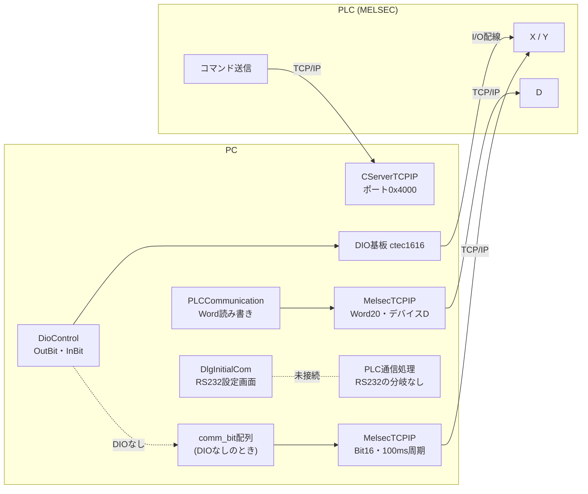
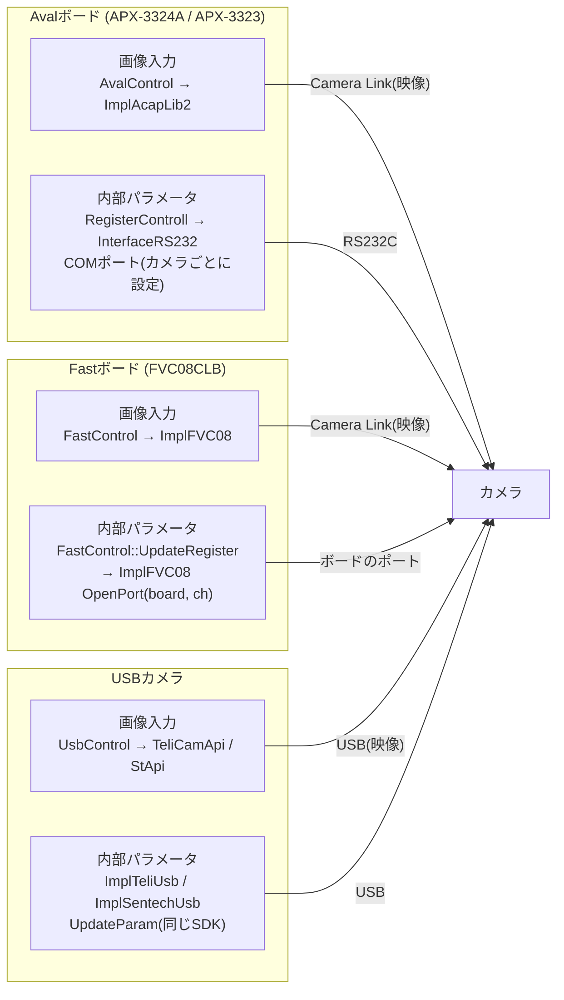

# Luv_Vision 通信・カメラ入力 仕様まとめ

2026-10-12 時点

## 概要

対象は Luv_Vision_AlignSystem の ZIP版(Ver10_21_1_3)。PLCとの通信、カメラ画像入力、カメラ内部パラメータの経路を、コードで確認できた範囲だけでまとめた。

- 確認方法: ソースを読み、呼び出し元まで追った。実機での動作は未確認。
- 「不明」と書いた点は、コードから判断できない。推測は書いていない。
- 例外: Camera Linkを使うボードがあることは、運用者(honda)の実機使用経験による。コード内の「カメラリンク」コメントとも一致する。
- スコープ・視野・コマンドの仕様は、別Doc「アライメントシステム要約」を参照。

## 通信系の全体図

PLCとはTCP/IPかDIO基板で通信する。RS232はPLC用の設定だけがあり、通信処理には接続されていない。カメラは、ボードの種類(Aval、Fast、USB)ごとに、画像入力とカメラ内部パラメータの送信がセットで決まる。

### 図1: PLC通信

### 図2: カメラ(ボードの種類ごと)

同じボードの中に、画像入力とカメラ内部パラメータの送信が並ぶ。AvalボードはRS232、Fastボードはボードのポート、USBカメラはメーカーSDKで内部パラメータを送る。`FastControl` は、画像入力とパラメータ送信の両方を持つ1つのクラス。

## PLC通信

PLCと通信できるのは三菱MELSECのTCP/IPだけ。RS232は設定画面に項目があるが、通信処理に接続されていない。

| 経路 | PC側 | 手段 | PLC側 | 備考 |
| --- | --- | --- | --- | --- |
| 1. DIOあり(ビット) | DioControl → DIO基板(ctec1616) | I/O配線 | X/Y | 初期値。DIO基板は DIO-1616L-PE |
| 2. DIOなし(ビット) | comm_bit配列 ↔ MelsecTCPIP(Bit16) | TCP/IP | X/Y | 100ms周期で同期(次章) |
| 3. Dデータ | PLCCommunication → MelsecTCPIP(Word20) | TCP/IP | D | DIOの有無に関係なし。デバイス 'D' のみ |
| 4. トリガー受信 | CServerTCPIP(ポート0x4000) | TCP/IP | → PC | PLCがコマンド番号とデータ最大4ワードを送り、PCがE000で応答 |
| 5. RS232 | DlgInitialCom(設定画面) | なし | なし | 設定とini保存のみ。通信処理に分岐なし |

- PLCの読み書きは `PLCCommunication` が「`plc.type==0x01`(三菱MELSEC)かつ `tcp.enable`」のときだけ `MelsecTCPIP` を呼ぶ。それ以外は何もせず、戻り値は失敗(1)のまま。
- キーエンスKV(`plc.type==0x11`)は分岐だけで、中身は「未対応」。
- 設定画面のラジオボタンはTCP/IPとRS232の排他選択。RS232を選ぶと `rs232.enable` が1になるが、この値を読むのは設定画面とini保存だけ。
- RS232の初期値: 無効、COM1、9600bps、8ビット、パリティなし、ストップ1、フロー制御なし。
- PLCとのデータは×10000の固定小数点。
- `PLCCommunication.h` の説明は「PLCとのシリアル通信メインクラス」だが、実際の中身はTCP/IPの分岐だけ。
- RS232選択肢が残っている理由はコードから不明。

## DIOなしモード

DIOなしでも動く。ビット番号と上位のロジックは同じで、変わるのはDIO基板からPLCのX/Yデバイス(TCP/IP)への切替だけ。

- 設定: `sys_option.io_unit_less`(ini `[System] io_unit_less`、初期値FALSE)。チェックすると設定画面でX/Yデバイス番号の入力が必須。起動時のY*Fチェックは省略。
- ビット番号(DIOと共通): 出力 RDY=0, BSY=1, LAT=2, OK=3, NG=4, OV=5, ERR=13, MAN=14。入力 STO=8, DT1〜6=9〜14, FBT=15。
- `dio.OutBit` / `InBit` / `EchoBit` / `GetCommand` は、DIO基板の代わりに `comm_bit.outdata_bit[]` / `indata_bit[]` を読み書きする。`StartTRG` / `StopTRG` は何もしない。
- 同期: 待機中(`CMD_RDY`)だけ、100msごとの `TIM_IO_UPDATE` で `TrRWBit` を起動。PLCのYデバイスを1ワード読んで `indata_bit[0..15]` へ(`ReadBit16`)、`outdata_bit[0..15]` をPLCのXデバイスへ書く(`WriteBit16`)。その後、トリガー処理を判定。
- DIOの即時入出力と違い、最大100ms程度の遅れが入る。
- 失敗時: 5回連続失敗で異常扱い(2回目でTCPを閉じ、3回目でポップアップ)。さらに `WM_APP_COMMAND_IO_LESS_ERR` を発行。更新100回ごと(約10秒)にTCPを閉じる。
- 不明: BUSY/OK/NGを出すタイミングがDIOありと同じか(`CommandStart` / `OutBitSuccess` / `OutBitFail` を未読)。トリガーをYビットで受けるか、トリガーサーバーで受けるかの運用上の選択。

## カメラ画像入力

画像は、Camera Linkのボード(Aval、Fast)とUSBの3系統から取り込む。どれを使うかは、カメラ1〜4(組1)とカメラ5〜8(組2)の4台を1組として設定されるコードで決まる。

- 1コマンドは1テンプレート=1カメラの最新フレームを取る(`GetLastImage`)。`cmd_param` → `sys_template` → `sys_scope[scope].view[view].assign_camera` でカメラが決まる。
- 切替は `dev_parameter.grab[cam/4]` の `interface_code`(1=Camera Link、2=USB)と `vender_code`(1=Aval、2=Fast)。
- `CAM_NUM_BOARD` は4。`cam/4` と `cam/CAM_NUM_BOARD` は同じ値になる。

| 入力 | 制御クラス | 下位 | 備考 |
| --- | --- | --- | --- |
| Aval(Camera Link) | AvalControl | ImplAcapLib2 | アバールデータ製画像入力ボード。カメラごとのiniファイルを使う |
| Fast(Camera Link) | FastControl | ImplFVC08 | ファースト製ボード(K34004)。カメラごとのxmlファイルを使う |
| USB | UsbControl | ImplTeliUsb(TeliCamApi)、ImplSentechUsb(StApi) | カメラシリアル番号で対応付け |

- 設定GUI: 画像入力の初期設定画面(`DlgInitialGrab`)。ボードごとにCamera Link/USBを選び、ボード型式、カメラごとのメーカーと型式を選ぶ。
- 2点と2点のアライメントでは、1コマンド1点なので、マーク撮像は合計4回。視野に割り当てるカメラは同じでもよい。
- Aval/FastをCamera Linkとする根拠: `ProcGrabImage.cpp` のコメント「カメラリンク」(`interface_code==0x01`)。ボードとカメラの物理規格を示す記述は他にない。

## カメラ内部パラメータ

カメラ本体の設定を、起動時にPCから送る仕組み。送るのは、設定が「設定を変更」(`regi_setting==1`)のカメラだけで、経路は画像入力の方式で分かれる。

- ボードごとの送り方: Avalボード=RS232(`RegisterControll`)、Fastボード=ボードのポート(`FastControl::UpdateRegister`)、USB=メーカーSDK(`UpdateParam`)。Avalボードのカメラが `FastControl` を通ることはない。

- 中身(機種で異なる): 基準クロック周波数(`clk`)、タップ数(`tap`)、露光時間(`exposure_time`)、画像反転(`flip`)。VC-25MCは露光時間だけ、USBカメラは露光時間と反転だけ。
- GUI: 画像入力の初期設定画面(`DlgInitialGrab`)で、カメラごとに「初期値を使用」「設定を変更」を選ぶ。「設定を変更」で設定ボタンが有効になり、機種別ダイアログ(`DlgInitBC040` / `BC160` / `BC302` / `BC505` / `VC25MC` / `STCSPB`)が開く。
- 「設定を変更」から「初期値を使用」に戻すと、再起動を案内する。COMポートは未設定(0)に戻る。

| 経路 | 対象 | 送るタイミング | 手段 | 条件・備考 |
| --- | --- | --- | --- | --- |
| RS232 | AvalボードのCamera Linkカメラ | 起動時 `CamRegiUpdate()` → `CRegisterControll::UpdateRegister` | InterfaceRS232(COMポート) | グラバのモデルコードが 0x1101(APX-3324A)か 0x1102(APX-3323)。メーカー別(東芝テリー、VIEWORKS、オムロンセンテック)に関数が分かれる |
| ボード経由 | FastボードのCamera Linkカメラ | ボード初期化時 `CFastControl::UpdateRegister` | ImplFVC08 `OpenPort(board, ch)` | COMポートは使わない。東芝テリーのBCシリーズ4機種 |
| USB | USBカメラ | USBカメラ初期化時 `InitUsb` → `UpdateParam` | メーカーSDK | 露光時間と反転。COMポートなし |

- RS232経路で送信に失敗すると、「カメラパラメータ 更新失敗」のエラーを出して初期化を中断する。
- COMポート: Avalボードのカメラだけで、カメラごとに選ぶ(`regi_param.com_port`、機種別ダイアログのコンボボックス)。未設定(0)のまま確定すると「カメラパラメータのCOM設定が未完了」のエラー。Fastボードではコンボボックスが無効になる。
- Avalボードのオムロンセンテックカメラは「設定を変更」が必須(「初期値を使用」だとエラー)。
- PLC通信用のRS232設定(COM1など)とは別物。こちらは実際に使われる。
- 不明: COMポートからカメラまでの実際の配線、USB経路で `regi_setting` を見ているか。

## 使えるカメラの制約

Avalが最も広く、FastとUSBには制限がある。画像入力の初期設定画面(`DlgInitialGrab`)のチェック処理が、組み合わせのエラーを出す。

| 画像入力 | 使えるカメラ | 使えないカメラ(エラー文) |
| --- | --- | --- |
| Aval(Camera Link) | 東芝テリー、VIEWORKS、オムロンセンテック(STC-SPB)、AVALDATA(ABA) | CIS(「CISは使用できません」)、USBカメラ(「USBカメラは選択できません」) |
| Fast(Camera Link) | 東芝テリーのBC040M、BC160M、BC302LMG、BC505LMGの4種だけ | 東芝テリー以外(「東芝テリー以外のカメラは使用できません」)、CSCV90BC3(「CSCV90BC3は使用できません」)、CIS、USBカメラ |
| USB | 東芝テリー(BU系)、オムロンセンテック(STC-MBS系) | 上記以外のメーカー(「東芝テリー/オムロンセンテック以外のカメラは使用できません」)、Camera Linkカメラ(「カメラリンクカメラは選択できません」) |

- カメラ選択のプルダウンには、ボードの種類による絞り込みがない(コード上は `|| TRUE` で無効)。選べても、確定時のチェックで弾かれる。
- Fastボードの「東芝テリーの4種のみ」は、コード内のコメントにもある。カメラごとのxmlファイルを持つのも、この4機種だけ。
- CIS: メーカー一覧(0x02)と「CIS CAM1/CAM2」(設定ファイル `test1.ini` / `test2.ini`)の定義があるが、コメントに「現在未対応」とあり、選ぶとエラー。CISが何を指すかはコードから不明。
- Avalボードでオムロンセンテックカメラを使うときは、カメラパラメータを「設定を変更」にしてCOMポートも設定しないとエラー。
- このチェックが確定時に必ず実行されるかは、呼び出し側を追っていないので不明。

## 未確認・不明な点

コードから判断できなかった点。実機か作者(M.Iwasaki)への確認が必要。

| 項目 | 状況 | 確認先 |
| --- | --- | --- |
| DIOなしでのBUSY/OK/NG出力タイミング | `CommandStart` / `OutBitSuccess` / `OutBitFail` を未読 | DlgSystemMain.cpp |
| トリガーをYビットで受けるか、トリガーサーバー(0x4000)で受けるか | コードだけでは運用上の選択が不明 | 実機の設定、PLCラダー |
| PLC用RS232の選択肢が残っている理由 | 通信処理に分岐なし。理由は不明 | 作者、Git履歴 |
| Aval/Fastボードとカメラの物理規格 | Camera Linkは運用者の実機経験とコメントによる。コードに規格名の記述はない | 実機 |
| カメラ内部パラメータのCOMポートからカメラまでの配線 | コードに記述なし | 実機 |
| USB経路で `regi_setting` を見ているか | `ImplTeliUsb` / `ImplSentechUsb` の `UpdateParam` をここまでは未読 | ImplTeliUsb.cpp、ImplSentechUsb.cpp |
| CISが何を指すか | メーカー名として定義されているが未対応 | 作者 |
| 画像入力設定(`dev_parameter.grab`)の設定画面の実際の操作 | リソース(.rc)を未読 | DlgInitialGrab.cpp、実機 |
| 設定確定時にカメラ選択チェックが必ず実行されるか | 呼び出し側を未読 | DlgInitialGrab.cpp |
